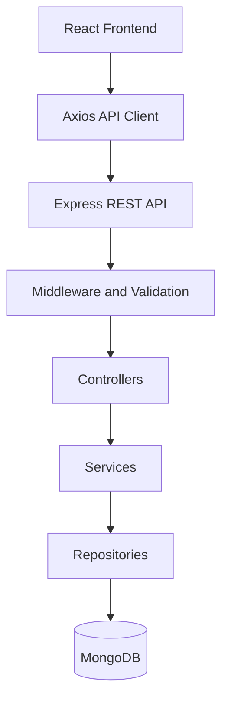

# Workshop Booking Application

A full-stack application for browsing workshops, booking seats, and managing workshops through an admin account.

## Live Demo

Visit the deployed application: [https://workshop-1-sxzr.onrender.com/](https://workshop-1-sxzr.onrender.com/)

### Demo Login Accounts

| Role | Email |
| --- | --- |
| Admin | `admin@example.com` |
| User | `user1@example.com` |
| User | `user2@example.com` |

Passwords are intentionally not published in this public repository. Keep
demo passwords private, and rotate any password that has been shared publicly.

## 1. Installation and Setup

### Prerequisites
- Node.js 18+
- MongoDB configured as a replica set
- npm

### Backend Setup

```powershell
cd backend
npm install
Copy-Item .env.example .env
```

Configure `backend/.env` with your MongoDB connection string, JWT secret, client URL, and seed credentials.

Start the backend:

```powershell
npm run seed
npm run dev
```

Backend: `http://localhost:5000`

### Frontend Setup

Open another terminal:

```powershell
cd frontend
npm install
Copy-Item .env.example .env
```

Configure `frontend/.env`:

```env
VITE_API_URL=http://localhost:5000
```

Start the frontend:

```powershell
npm run dev
```

Frontend: `http://localhost:5173`

## 2. Free Deployment (Render + MongoDB Atlas)

This setup uses a Render free web service for the API, a Render free static
site for the React frontend, and a MongoDB Atlas free cluster. Free Render web
services sleep after inactivity and may take about a minute to wake up; this
setup is for demos, not production.

### Create the database

1. Create a free MongoDB Atlas cluster and a database user with a strong,
   unique password.
2. In Atlas Network Access, add `0.0.0.0/0` so Render can reach the cluster.
   Render's free services do not provide a fixed outbound IP. Use a
   least-privilege database user and never publish the connection string.
3. Copy the Atlas application connection string. Select a database name such
   as `workshop_booking` and replace the username and password placeholders.

### Deploy the backend

1. In Render, create a **Web Service** from the GitHub repository
   `Chethumuniraju/workshop`, using the `main` branch.
2. Configure:

   | Setting | Value |
   | --- | --- |
   | Root Directory | `backend` |
   | Build Command | `npm ci` |
   | Start Command | `npm start` |
   | Instance Type | Free |

3. Add these environment variables in Render. Do not commit their values:

   | Key | Value |
   | --- | --- |
   | `NODE_ENV` | `production` |
   | `MONGODB_URI` | Atlas connection string |
   | `JWT_SECRET` | Random secret of at least 32 characters |
   | `CLIENT_URL` | Set to the frontend URL after creating the static site |

   Generate a secret locally with:

   ```powershell
   node -e "console.log(require('crypto').randomBytes(48).toString('hex'))"
   ```

   Render supplies `PORT` automatically. After the first successful deploy,
   copy the service URL (for example, `https://your-api.onrender.com`).

### Deploy the frontend

1. In Render, create a **Static Site** from the same repository and branch.
2. Configure:

   | Setting | Value |
   | --- | --- |
   | Root Directory | `frontend` |
   | Build Command | `npm ci && npm run build` |
   | Publish Directory | `dist` |

3. Add the build environment variable `VITE_API_URL` with the backend service
   URL copied above. Do not add `/api` to the end.
4. Add a rewrite rule so client-side routes load correctly:
   source `/*`, destination `/index.html`, action **Rewrite**.
5. Copy the static site's URL and set it as `CLIENT_URL` in the backend
   service's Render environment. Save the change to redeploy the API.

### Seed sample data (optional)

Set `MONGODB_URI` in `backend/.env` to the Atlas connection string, and replace
the example seed emails and passwords with unique values. From the repository
root, run:

```powershell
Set-Location backend
npm run seed
```

Keep `backend/.env` private and use unique passwords for public demo accounts.
The live application is available at
[https://workshop-1-sxzr.onrender.com/](https://workshop-1-sxzr.onrender.com/).

## 3. High-Level Architecture



- **Frontend:** React, Redux Toolkit, React Router, and Material UI.
- **Backend:** Node.js and Express for API handling.
- **Authentication:** JWT authentication and role-based authorization.
- **Validation:** Joi for validating incoming requests.
- **Database:** MongoDB for users, workshops, and bookings.

## 4. Low-Level Architecture

### Backend

- `config/` — Environment and database configuration.
- `routes/` — API endpoint definitions.
- `middleware/` — Authentication, authorization, validation, and error handling.
- `validators/` — Request validation schemas.
- `controllers/` — Handle requests and responses.
- `services/` — Business logic and booking workflows.
- `repositories/` — Database operations.
- `models/` — MongoDB schemas and indexes.
- `app.js` — Express application configuration.
- `server.js` — Database connection and server startup.

### Frontend

- `pages/` — Login, registration, workshops, bookings, and admin screens.
- `components/` — Reusable UI components.
- `features/` — Authentication, workshop, and booking logic.
- `services/` — API communication using Axios.
- `routes/` — Application routing and protected routes.
- `app/` — Redux store and hooks.

## 5. Booking Flow

1. The user logs in and receives a JWT.
2. The frontend requests available workshops from the backend.
3. The user selects a workshop and submits a booking request.
4. The backend validates the request and checks seat availability.
5. A MongoDB transaction reserves a seat and creates the booking.
6. The frontend displays the booking result and updates availability.

**Booking safety:** Conditional atomic updates prevent overbooking, transactions keep booking records and seat counts consistent, and a unique index prevents duplicate active bookings.

## 6. Pending Work

### Reliability and Testing
- [ ] Add automated backend and frontend tests.
- [ ] Test concurrent bookings and transaction rollback.
- [ ] Add safe retry handling for database failures.
- [ ] Implement idempotency for requests retried after uncertain outcomes.

### Performance and Scaling
- [ ] Review MongoDB connection-pool settings.
- [ ] Add caching for suitable read-heavy data if needed.
- [ ] Optimize database queries and indexes based on measurements.
- [ ] Load-test concurrent booking requests.

### Production Readiness
- [ ] Add structured logging and monitoring.
- [ ] Improve health checks and database recovery.
- [ ] Review production security settings.
- [ ] Deploy the application.
- [ ] Add an admin attendee-management view if required.

**Note:** Automated test files have not yet been added. These are planned improvements, not completed features.
