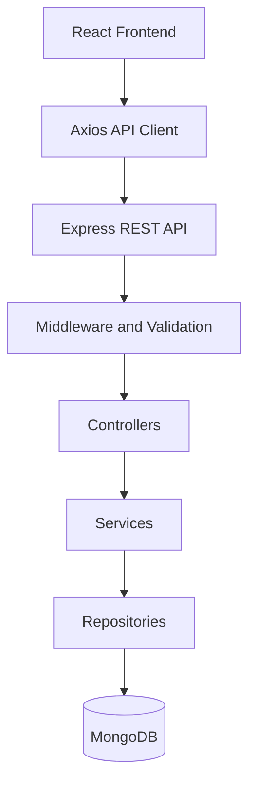

# Workshop Booking Application

A full-stack application for browsing workshops, booking seats, and managing workshops through an admin account.

## 1. Installation and Setup

### Prerequisites
- Node.js 18+
- MongoDB configured as a replica set
- npm

### Backend Setup

```powershell
cd backend
npm install
Copy-Item .env.example .env
```

Configure `backend/.env` with your MongoDB connection string, JWT secret, client URL, and seed credentials.

Start the backend:

```powershell
npm run seed
npm run dev
```

Backend: `http://localhost:5000`

### Frontend Setup

Open another terminal:

```powershell
cd frontend
npm install
Copy-Item .env.example .env
```

Configure `frontend/.env`:

```env
VITE_API_URL=http://localhost:5000
```

Start the frontend:

```powershell
npm run dev
```

Frontend: `http://localhost:5173`

## 2. High-Level Architecture



- **Frontend:** React, Redux Toolkit, React Router, and Material UI.
- **Backend:** Node.js and Express for API handling.
- **Authentication:** JWT authentication and role-based authorization.
- **Validation:** Joi for validating incoming requests.
- **Database:** MongoDB for users, workshops, and bookings.

## 3. Low-Level Architecture

### Backend

- `config/` — Environment and database configuration.
- `routes/` — API endpoint definitions.
- `middleware/` — Authentication, authorization, validation, and error handling.
- `validators/` — Request validation schemas.
- `controllers/` — Handle requests and responses.
- `services/` — Business logic and booking workflows.
- `repositories/` — Database operations.
- `models/` — MongoDB schemas and indexes.
- `app.js` — Express application configuration.
- `server.js` — Database connection and server startup.

### Frontend

- `pages/` — Login, registration, workshops, bookings, and admin screens.
- `components/` — Reusable UI components.
- `features/` — Authentication, workshop, and booking logic.
- `services/` — API communication using Axios.
- `routes/` — Application routing and protected routes.
- `app/` — Redux store and hooks.

## 4. Booking Flow

1. The user logs in and receives a JWT.
2. The frontend requests available workshops from the backend.
3. The user selects a workshop and submits a booking request.
4. The backend validates the request and checks seat availability.
5. A MongoDB transaction reserves a seat and creates the booking.
6. The frontend displays the booking result and updates availability.

**Booking safety:** Conditional atomic updates prevent overbooking, transactions keep booking records and seat counts consistent, and a unique index prevents duplicate active bookings.

## 5. Pending Work

### Reliability and Testing
- [ ] Add automated backend and frontend tests.
- [ ] Test concurrent bookings and transaction rollback.
- [ ] Add safe retry handling for database failures.
- [ ] Implement idempotency for requests retried after uncertain outcomes.

### Performance and Scaling
- [ ] Review MongoDB connection-pool settings.
- [ ] Add caching for suitable read-heavy data if needed.
- [ ] Optimize database queries and indexes based on measurements.
- [ ] Load-test concurrent booking requests.

### Production Readiness
- [ ] Add structured logging and monitoring.
- [ ] Improve health checks and database recovery.
- [ ] Review production security settings.
- [ ] Deploy the application.
- [ ] Add an admin attendee-management view if required.

**Note:** Automated test files have not yet been added. These are planned improvements, not completed features.
